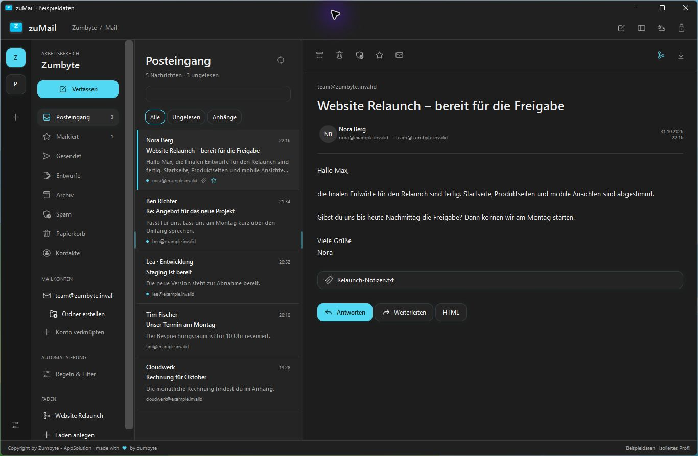
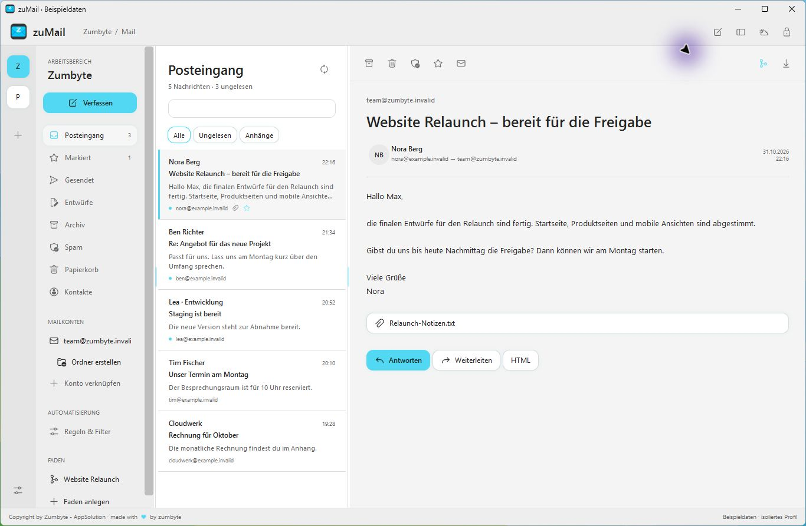
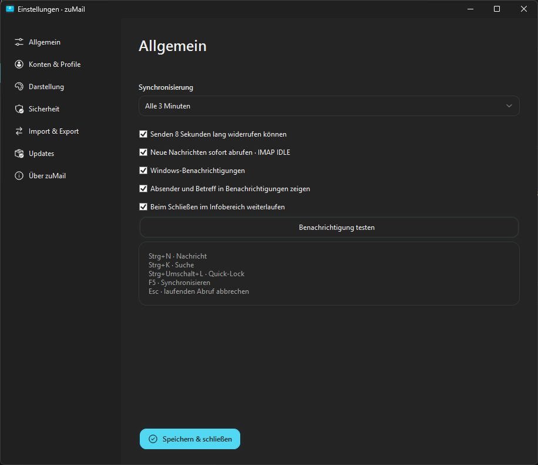

<h1 align="center">zuMail</h1>

Korrespondenz mit Charakter.

<a href="https://github.com/ZUMBYTE-AppSolution/zuMail/releases/tag/v0.1.0-alpha.2">Herunterladen</a> · <a href="docs/Anleitung.md">Anleitung</a> · <a href="CHANGELOG.md">Changelog</a> · <a href="https://www.zumbyte.de/support/">Support</a>

 

**zuMail** ist ein nativer Windows-Mailclient von **Zumbyte - AppSolution**. Mehrere Arbeitsbereiche, Mailkonten, Profile und Kontakte bleiben übersichtlich erreichbar. Anthrazit oder Light Mode, eigene Akzentfarbe und verschiebbare Bereiche passen die Ansicht an deinen Alltag an.

| Ausgabe | Download |
| --- | --- |
| Windows 10 / 11 x64 · Installer | [Setup herunterladen](https://github.com/ZUMBYTE-AppSolution/zuMail/releases/download/v0.1.0-alpha.2/zuMail-0.1.0-alpha.2-win-x64-Setup.exe) |
| Windows x64 · ohne Installation | [Portable ZIP herunterladen](https://github.com/ZUMBYTE-AppSolution/zuMail/releases/download/v0.1.0-alpha.2/zuMail-0.1.0-alpha.2-win-x64-Portable.zip) |
| Prüfsummen | [SHA256SUMS.txt](https://github.com/ZUMBYTE-AppSolution/zuMail/releases/download/v0.1.0-alpha.2/SHA256SUMS.txt) |

Die benötigte .NET-Laufzeit ist enthalten. Windows-Pakete sind derzeit unsigniert.

## Einblicke

| Light Mode | Einstellungen |
| --- | --- |
|  |  |

Die Bilder zeigen ausschließlich getrennte Beispieldaten.

## Aktuelles Changelog · Alpha 2

- Gmail-Auswahl startet direkt die Browser-Anmeldung mit der gemeinsamen zuMail-Registrierung.
- Keine Schlüssel-Eingabe oder eigene App-Registrierung für Mailnutzer.
- Bestehende Anmeldungen behalten beim Update ihre ursprüngliche Client-Zuordnung.

Bereits enthalten:

- IMAP/SMTP, Arbeitsbereiche, Absenderprofile und automatische Servererkennung.
- WYSIWYG-Nachrichten, Anhänge, Antworten, Weiterleiten und Entwürfe.
- Kontakte mit Empfängerwahl, Livevorschlägen und vCard-Import/-Export.
- Lokale und Serverordner über Rechtsklick; eigene Filter, Spamlisten und Automationen.
- Windows-Benachrichtigungen, IMAP IDLE, Hintergrundbetrieb, PIN und Autolock.
- Verschlüsselter Speicher, passwortgeschützte Backups und GitHub-Updater.
- Rastericon mit Brief, Z und Cyan-Glow; scharfe Buttontexte und linksbündige Navigation.

[Alle Änderungen](CHANGELOG.md) · [Versionen](https://github.com/ZUMBYTE-AppSolution/zuMail/releases)

## Funktionen

| Bereich | Enthalten |
| --- | --- |
| Mail | TLS-geschützte IMAP-/SMTP-Verbindungen, lokale Suche, Anhänge, HTML-Leseansicht mit blockierten externen Inhalten. |
| Verfassen | Formatierung, Listen, Links, Tabellen, eingebettete Bilder, Signaturen und Klartextalternative. Versand acht Sekunden lang stoppen. |
| Kontakte | Namen, mehrere Mailadressen und Telefonnummern, Firma, Anschriften, Daten, Foto, Notizen und weitere Felder. Wahlweise Anbieterabgleich. |
| Regeln | Absender, Betreff, Inhalt, Empfänger und Anhänge kombinieren. Verschieben, markieren, Schlagwörter und Spamaktionen; Vorschau und Verlauf. |
| Faden | Mails aus mehreren Konten eines Arbeitsbereichs mit Notizen und Aufgaben zu einem Projekt verbinden. Die Originalmails bleiben in ihren Ordnern. |
| Schutz | Lokaler AES-256-GCM-Speicher mit Windows-DPAPI, verschlüsselte Sicherungen, optionale 4-/6-stellige PIN, Quick-Lock und Autolock. |
| Ansicht | Dark/Light Mode, frei wählbare Akzentfarbe, drei Leselayouts, verstellbare Bereichsgrenzen. |

## Installation und erster Start

1. Setup ausführen oder die portable ZIP vollständig entpacken und zuMail.exe starten.
2. Einen Arbeitsbereich anlegen und **Konto verknüpfen** wählen.
3. Anbieter auswählen oder über **Freie Eingabe** die Server automatisch ermitteln lassen.
4. Für eine Vorschau ohne echte Konten die Verknüpfung **zuMail Beispieldaten** bzw. Beispieldaten.cmd verwenden.

Die gemeinsame Google-Registrierung ist enthalten. Mailnutzer brauchen keine eigenen OAuth-Schlüssel. Im Google-Testmodus dürfen nur eingetragene Testnutzer zugreifen; die öffentliche Freigabe und Gmail-Prüfung liegen beim Herausgeber. Microsoft ist für diesen Build zurückgestellt und in der Anbieterauswahl ausgeblendet. [Anmeldung und Grenzen](docs/Anleitung.md).

**Konto verknüpfen → Gmail** öffnet direkt den Standardbrowser. Konto auswählen, den Zugriff bestätigen und zuMail übernimmt Server und Ports. Nach einem Abbruch lässt sich die Anmeldung erneut starten. Die manuelle Einrichtung ist eine separate Option.

[Informationen für den Herausgeber](docs/Anbieter-Anmeldung.md)

## Alpha-Stand und Daten

**86 automatische Prüfungen** für Mailprotokolle, Regeln, Verschlüsselung, Sicherungen, Kontakte, WYSIWYG und Oberfläche. Enthalten sind die mitgelieferte Google-Registrierung, der direkte Anmeldestart und die Migration bestehender Anmeldungen. Anbieterzugriffe wurden mit lokalen Testantworten geprüft; echte Google-/Microsoft-Anmeldungen wurden noch nicht getestet.

Pro geöffnetem IMAP-Ordner lädt dieser Build die letzten 100 Nachrichten; die Suche verwendet geladene Nachrichten. Serverlöschungen entfernen noch keine Cachekopien. Lokale Ordner lassen die Servernachricht bestehen. Google/Microsoft-Kontakte werden übernommen, Änderungen bleiben lokal; CardDAV unterstützt optionales Zurückschreiben mit Konfliktschutz. CardDAV benötigt die direkte Adressbuch-URL.

Windows-Benachrichtigungen benötigen eine laufende App bzw. Hintergrundbetrieb und beachten die Windows-Einstellungen. macOS, iOS, mobiler Push und OpenPGP/S/MIME folgen. Speicher- und Backupverschlüsselung sind bereits enthalten.

Profildaten liegen unter %LOCALAPPDATA%\Zumbyte\zuMail und bleiben bei Deinstallation erhalten. Für einen Gerätewechsel eine passwortgeschützte Sicherung exportieren.

## Hilfe und Kontakt

[Anleitung](docs/Anleitung.md) · [Fehler melden](https://github.com/ZUMBYTE-AppSolution/zuMail/issues) · [Support](https://www.zumbyte.de/support/)

Dieses Repository enthält Releases und Dokumentation. Der Entwicklungsquellcode liegt im privaten zuMail-dev-Repository. Drittkomponenten und ihre Lizenzen sind den Paketen beigefügt.

**Copyright by Zumbyte - AppSolution · made with ♥ by zumbyte**
