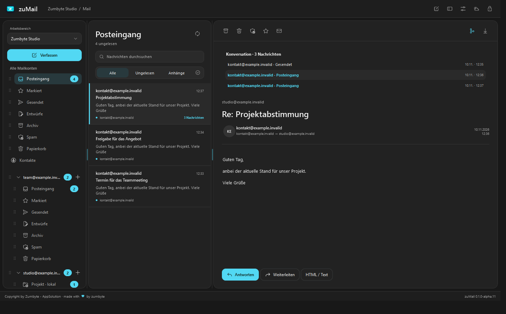
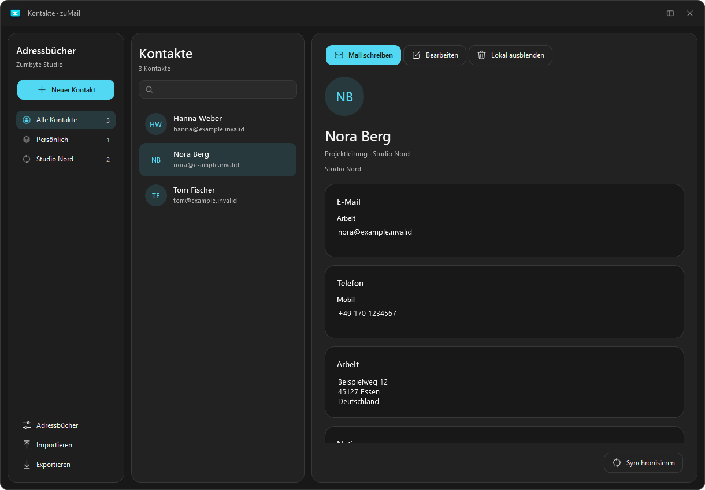
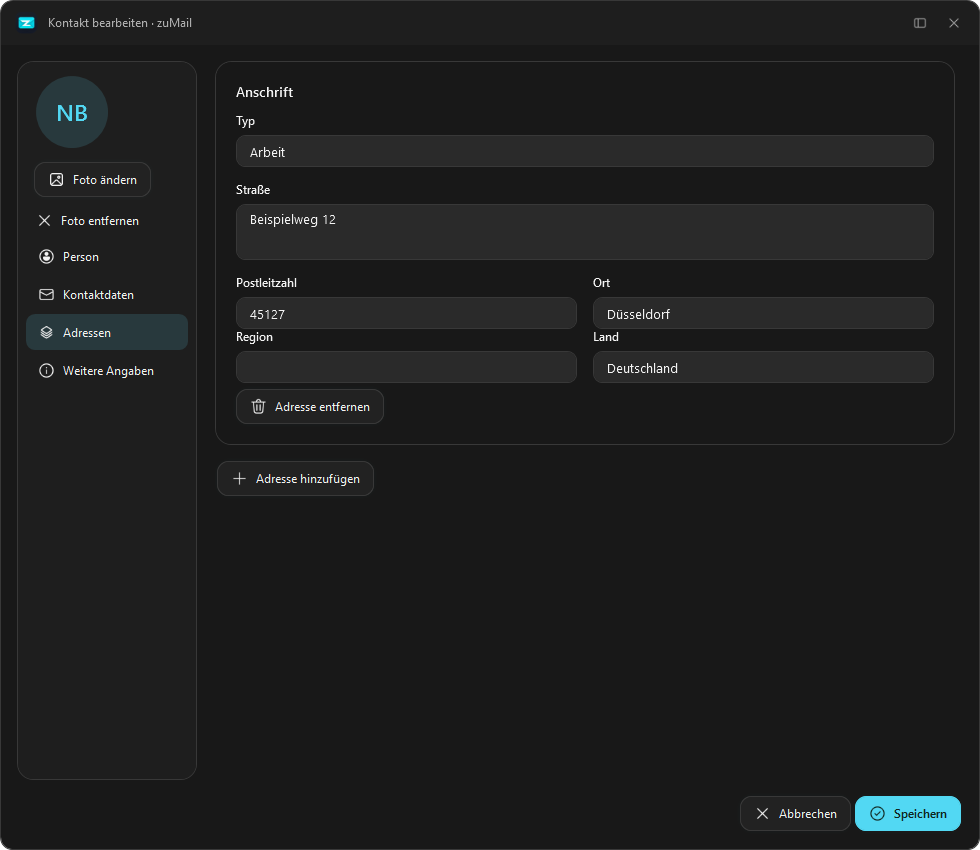
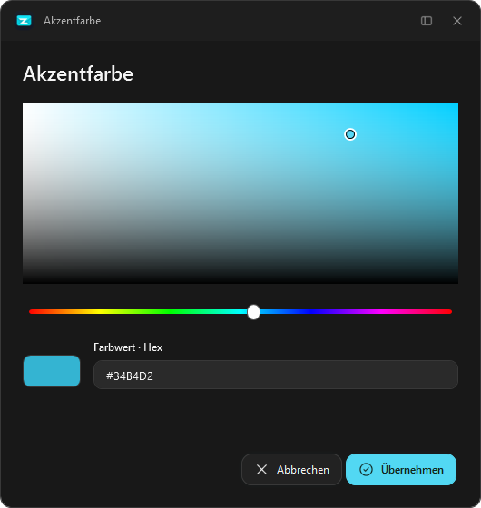
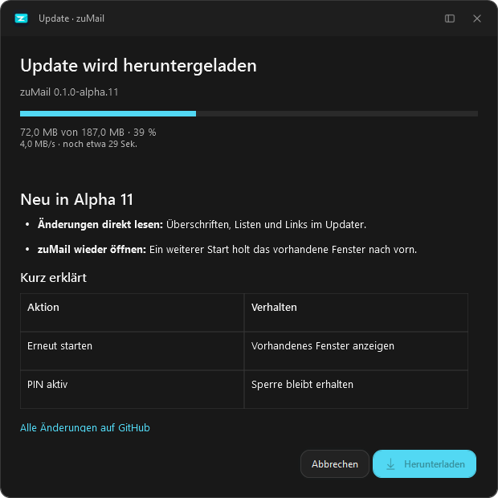
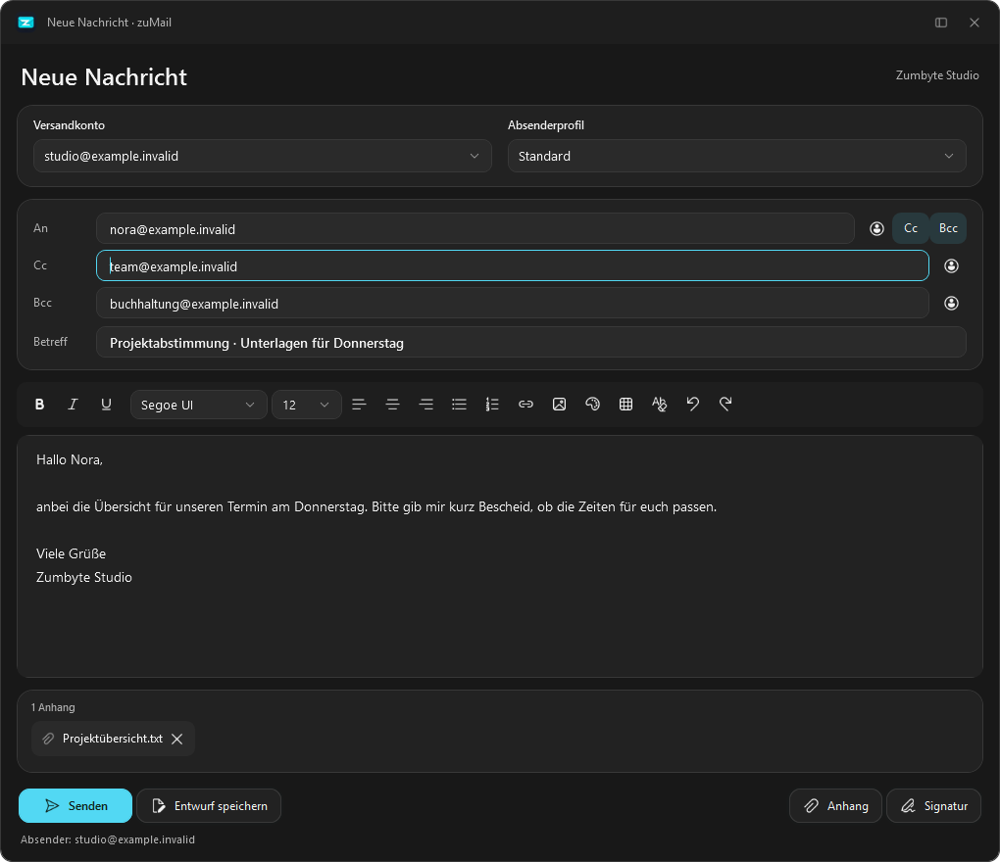

<h1 align="center">zuMail</h1>

Korrespondenz mit Charakter.

<a href="https://github.com/ZUMBYTE-AppSolution/zuMail/releases/tag/v0.1.0-alpha.11">Herunterladen</a> · <a href="docs/Anleitung.md">Anleitung</a> · <a href="CHANGELOG.md">Changelog</a> · <a href="https://www.zumbyte.de/support/">Support</a>

zuMail ist ein Mailprogramm für Windows von **Zumbyte - AppSolution**. Trenne private und geschäftliche Post in Arbeitsbereiche, verwalte mehrere Konten und behalte Nachrichten und Kontakte im Blick. Mit hellem oder dunklem Design, eigener Akzentfarbe und verstellbarer Aufteilung.

## Download · Alpha 11

| Für Windows 10 / 11 x64 | Download |
| --- | --- |
| Mit Installation | [zuMail installieren](https://github.com/ZUMBYTE-AppSolution/zuMail/releases/download/v0.1.0-alpha.11/zuMail-0.1.0-alpha.11-win-x64-Setup.exe) |
| Ohne Installation | [Portable ZIP herunterladen](https://github.com/ZUMBYTE-AppSolution/zuMail/releases/download/v0.1.0-alpha.11/zuMail-0.1.0-alpha.11-win-x64-Portable.zip) |
| Dateien überprüfen | [SHA-256-Prüfsummen](https://github.com/ZUMBYTE-AppSolution/zuMail/releases/download/v0.1.0-alpha.11/SHA256SUMS.txt) |

Die App befindet sich in der Alpha-Phase. Neue Profile starten leer; es werden keine Beispielmails oder Kontakte angelegt. Die Pakete sind derzeit unsigniert. Verfügbar für Windows x64; macOS und iOS sind geplant.

## Einblicke

### Posteingang

Arbeitsbereich und Konten links, Nachrichten in der Mitte, geöffnete Mail rechts. Ungelesene Nachrichten sind an den Zählern erkennbar.

### Kontakte

Adressbuch auswählen, Kontakt suchen und Details ansehen. Eine neue Mail lässt sich direkt aus dem Kontakt heraus beginnen.

Kontaktbearbeitung, Farbauswahl, Updates und Verfassen ansehen

**Kontakt bearbeiten**

**Farbe auswählen**

**Update herunterladen**

**Nachricht verfassen**

Die Screenshots zeigen eigens angelegte Testinhalte. Diese werden nicht mit der App ausgeliefert.

## Neu in Alpha 11

- **Änderungen im Updater formatiert lesen:** Überschriften, Listen, Hervorhebungen, Tabellen, Links und Screenshots werden direkt angezeigt. Text lässt sich markieren und kopieren. Die Ansicht passt sich dem hellen oder dunklen Design an.
- **zuMail erneut öffnen:** Ein weiterer Start holt das bereits geöffnete Fenster nach vorn. Minimierte oder im Infobereich versteckte Fenster werden wiederhergestellt; eine vorher maximierte Ansicht bleibt maximiert. Es erscheint keine Meldung „ist bereits geöffnet“ mehr.
- **Sperre und Arbeitsstand bleiben erhalten:** Die vorhandene Sitzung wird weiterverwendet. Eine aktive PIN-Sperre bleibt bestehen; ein zusätzlicher Windows-Autostart bleibt im Hintergrund.

[Alle Änderungen ansehen](CHANGELOG.md)

## Das kann zuMail

| Bereich | Funktionen |
| --- | --- |
| Konten & Arbeitsbereiche | Mehrere IMAP-/SMTP-Konten, automatische Serverermittlung, getrennte Arbeitsbereiche und Absenderprofile |
| Nachrichten | Konversationsansicht, Suche, Mehrfachauswahl, Sammelaktionen und Verschieben per Drag & Drop |
| Verfassen | Formatierter Text, An/Cc/Bcc mit Kontaktvorschlägen, Anhänge, Entwürfe und Versandwiderruf vor dem Senden |
| Lesen | HTML oder Text, separate Mailfenster, kopierbarer Inhalt und Anhangvorschau mit Speichern |
| Kontakte | Mehrere Kontaktdaten je Person, Fotos, vCard-Import/-Export und optionaler CardDAV-Abgleich |
| Ordnung | Lokale und Serverordner, eigene Regeln, Spamlisten sowie Projekte mit Notizen und Aufgaben |
| Anpassen | Dark/Light Mode, Farbauswahl, verstellbare Bereiche, schmale Scrollleisten und sortierbare Sidebar |
| Sicherheit | Verschlüsselter lokaler Speicher, optionale 4-/6-stellige PIN, Autolock und passwortgeschützte Sicherungen |
| Windows | Benachrichtigungen, einstellbare Töne, Hintergrundbetrieb und Autostart auf Wunsch minimiert |
| Updates | Formatierte Änderungshinweise, Downloadfortschritt und Neustart nach der Installation |

Externe Bilder in HTML-Mails werden erst nach Freigabe geladen. Auf Wunsch kannst du einer Absenderadresse dauerhaft vertrauen. Seitenskripte bleiben gesperrt.

## Installieren und starten

1. **Setup herunterladen** und ausführen. Alternativ die portable ZIP vollständig entpacken und `zuMail.exe` starten.
2. Im Arbeitsbereichsmenü **Neuer Arbeitsbereich** wählen und anschließend **Konto verknüpfen** öffnen.
3. Anbieter auswählen, Mailadresse und Passwort bzw. App-Passwort eingeben. Erkannte Serverdaten prüfen und verbinden.

Die Anmeldung erfolgt über IMAP/SMTP. Eine Browser-Anmeldung bei Google oder Microsoft ist nicht enthalten. Manche Anbieter benötigen ein App-Passwort; Konten, die ausschließlich Browser-Anmeldung erlauben, lassen sich in diesem Build nicht neu verbinden. [Hinweise zur Kontoeinrichtung](docs/Anbieter-Anmeldung.md).

.NET und Chromium sind enthalten. Falls die benötigte Microsoft-Visual-C++-Komponente fehlt, lädt der Installer sie direkt von Microsoft. Dafür werden Internet und gegebenenfalls eine Windows-Freigabe benötigt. Für die portable Ausgabe liegt `Runtime-Setup.cmd` bei.

## Updates und vorhandene Daten

Unter **Einstellungen → Informationen → Updates** nach einer neuen Version suchen. Download starten und anschließend **Jetzt installieren** wählen. Nach erfolgreicher Installation startet zuMail wieder mit dem bisherigen Profil.

Die portable Ausgabe bei geschlossener App in einen neuen Ordner entpacken. Das Profil liegt standardmäßig im Windows-Benutzerverzeichnis. Eine Deinstallation erhält die Profildaten. Für einen Gerätewechsel eine passwortgeschützte Sicherung aus zuMail verwenden.

## Hilfe und Hinweise

[Erste Schritte](docs/Anleitung.md) · [Kontoeinrichtung](docs/Anbieter-Anmeldung.md) · [Prüfbericht](docs/Pruefung.md) · [Support](https://www.zumbyte.de/support/)

Suche und Ordnerzähler beziehen sich auf lokal geladene Nachrichten. Nachrichtenverschlüsselung mit OpenPGP/S/MIME und mobiler Push sind noch nicht enthalten. Weitere Grenzen stehen in der Anleitung.

Copyright by Zumbyte - AppSolution · made with ♥ by zumbyte
