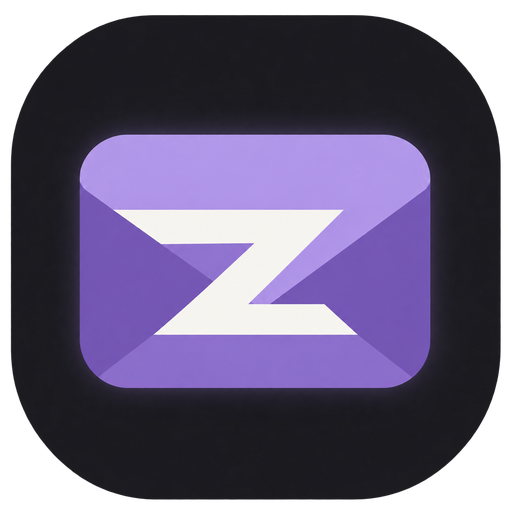
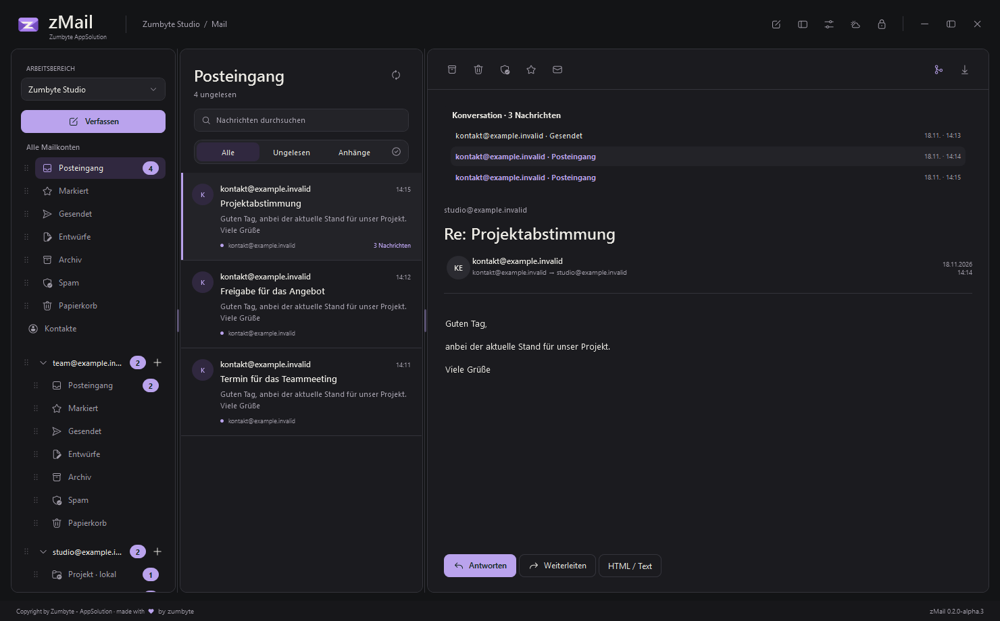
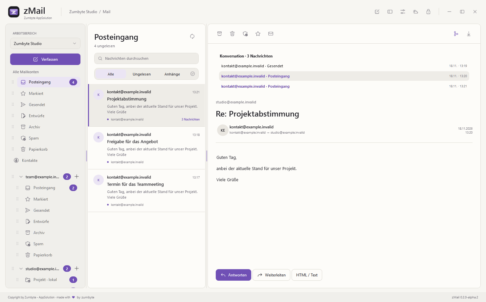
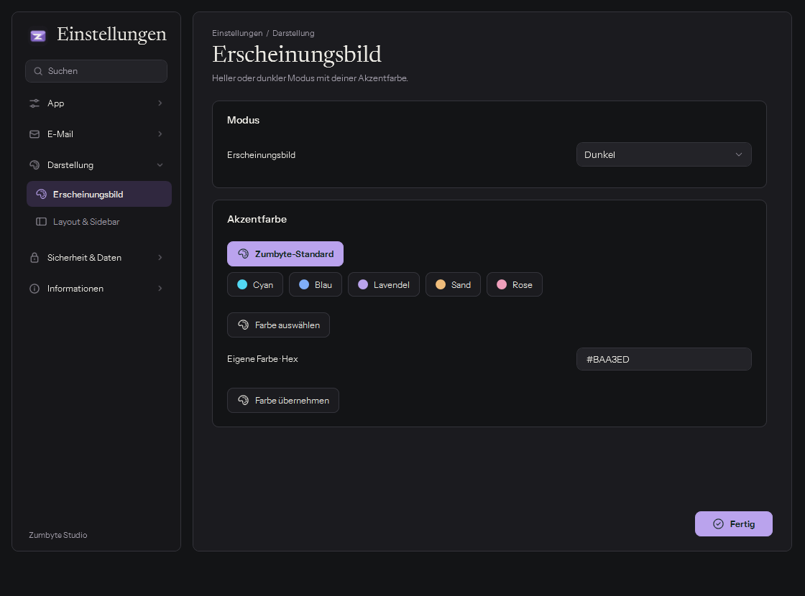
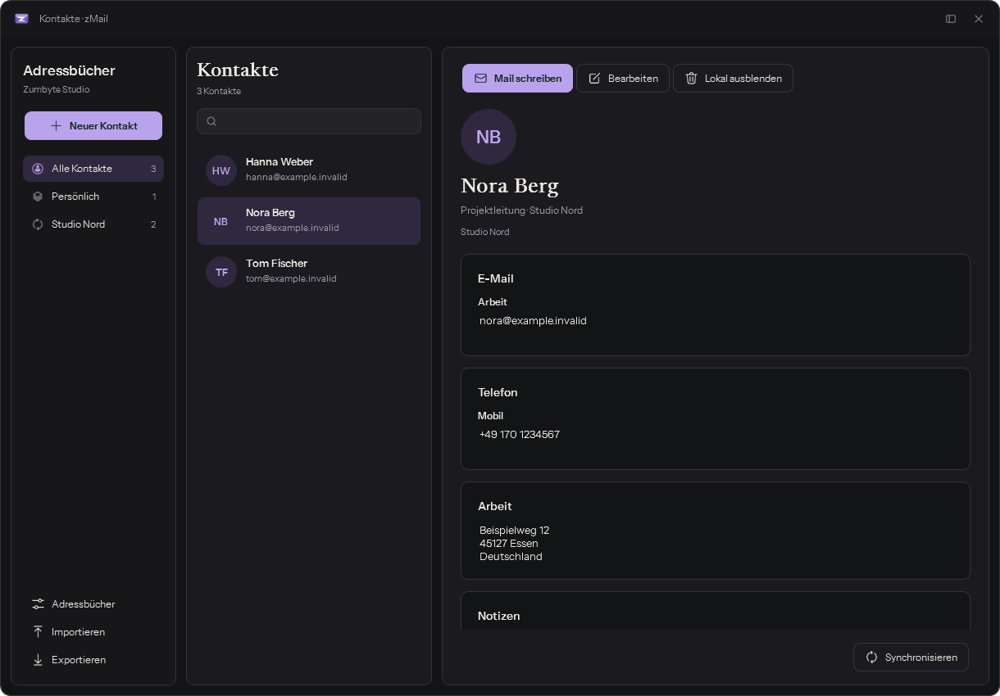
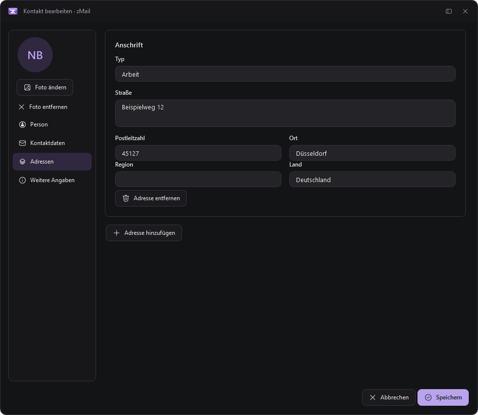
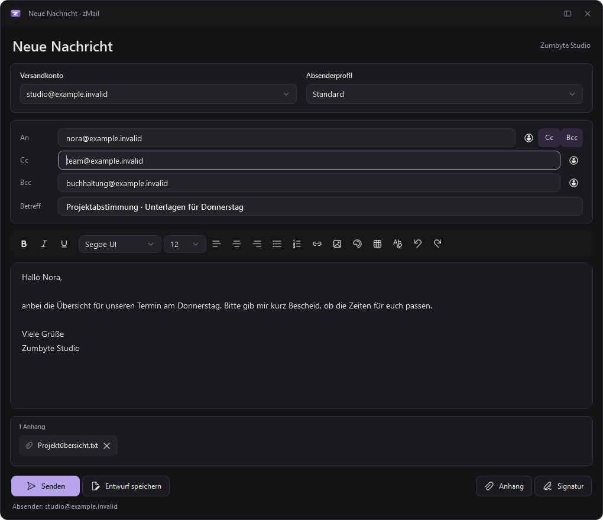
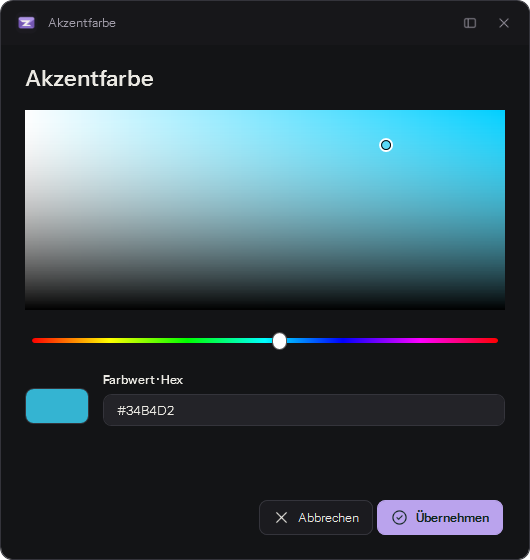
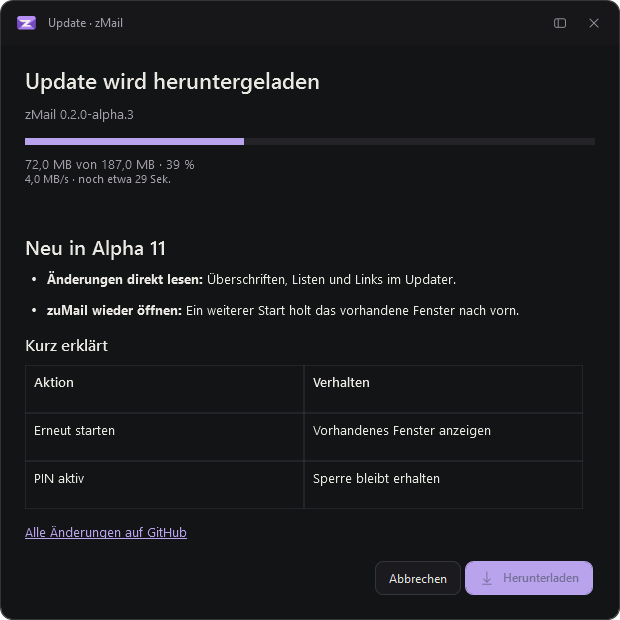
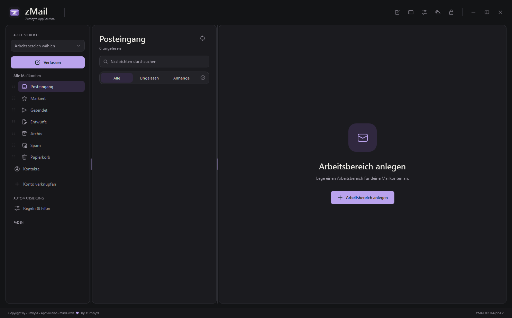

<h1 align="center">zMail</h1>

Korrespondenz mit Charakter.

<a href="https://github.com/ZUMBYTE-AppSolution/zuMail/releases/tag/v0.2.0-alpha.3">Herunterladen</a> · <a href="docs/Anleitung.md">Anleitung</a> · <a href="CHANGELOG.md">Changelog</a> · <a href="https://www.zumbyte.de/support/">Support</a>

zMail ist das Windows-Mailprogramm von **Zumbyte AppSolution**. Mehrere Mailkonten, getrennte Arbeitsbereiche, Kontakte und eigene Filter. Gestaltet im Stil von [zumbyte.de](https://zumbyte.de), mit dunkler oder heller Oberfläche und frei wählbarer Akzentfarbe.

**Bisher zuMail, jetzt zMail:** Deine bisherigen Konten und Nachrichten bleiben erhalten. Das Release-Repository bleibt unter seiner bisherigen Adresse erreichbar, damit der eingebaute Updater weiter funktioniert.

## Download

| Windows 10 / 11 x64 | Datei |
| --- | --- |
| Mit Installation | [zMail installieren](https://github.com/ZUMBYTE-AppSolution/zuMail/releases/download/v0.2.0-alpha.3/zMail-0.2.0-alpha.3-win-x64-Setup.exe) |
| Ohne Installation | [Portable ZIP herunterladen](https://github.com/ZUMBYTE-AppSolution/zuMail/releases/download/v0.2.0-alpha.3/zMail-0.2.0-alpha.3-win-x64-Portable.zip) |
| Dateien überprüfen | [SHA-256-Prüfsummen](https://github.com/ZUMBYTE-AppSolution/zuMail/releases/download/v0.2.0-alpha.3/SHA256SUMS.txt) · [Signaturprüfung](https://github.com/ZUMBYTE-AppSolution/zuMail/releases/download/v0.2.0-alpha.3/signing-verification.json) |

Programm, Installer und Deinstaller sind über **Microsoft Artifact Signing** digital signiert. Der zertifizierte Herausgeber im Windows-Sicherheitsdialog ist **Andreas Zumbansen**.

zMail befindet sich in der Alpha-Phase. Verfügbar für Windows x64; macOS und iOS sind geplant. Neue Profile starten ohne Beispielmails und Beispielkontakte.

## Einblicke

### Mailansicht · Dunkel

Arbeitsbereich und Konten links, Nachrichtenliste in der Mitte, geöffnete Mail rechts. Ungelesene Nachrichten stehen als Zähler direkt am Ordner.

### Mailansicht · Hell

Warme Papierfarben und derselbe Aufbau. Der Zumbyte-Akzent passt sich dem hellen Modus an.

### Einstellungen

Farbmodus, persönliche Akzentfarbe und Layout sind getrennt erreichbar. Der Colorpicker erlaubt auch eigene Farbwerte.

Kontakte, Verfassen, Updates und den ersten Start ansehen

**Kontakte**

**Kontakt bearbeiten**

**Nachricht verfassen**

**Farbe auswählen**

**Änderungshinweise und Downloadfortschritt**

**Leerer Erststart**

Für die Screenshots wurden getrennte Testprofile verwendet. Deren Kontakte und Nachrichten werden nicht mit der App ausgeliefert.

## Neu in 0.2.0-alpha.3

- Schärfere Symbole in Sidebar, Buttons, Menüs und bei der Anbieterauswahl. Die Originalkonturen passen sich der Bildschirmauflösung an.
- Das zMail-Logo erscheint innerhalb der App freigestellt und ohne Hintergrundkachel, in passender Auflösung für die jeweilige Anzeige.
- Anbieterlogos behalten ihre Proportionen und Farben. Apple und GitHub sind auch im dunklen Modus gut erkennbar.
- Segoe UI, das Zumbyte-Farbschema und vorhandene Profile bleiben erhalten. Windows-Pakete weiterhin mit Microsoft Artifact Signing signiert.

## Funktionen

| Bereich | Funktionen |
| --- | --- |
| Konten & Arbeitsbereiche | Mehrere IMAP-/SMTP-Konten, Serverermittlung, getrennte Arbeitsbereiche und Absenderprofile |
| Nachrichten | Konversationsansicht, Suche, Mehrfachauswahl, Sammelaktionen und Verschieben per Drag & Drop |
| Verfassen | Formatierter Text, An/Cc/Bcc mit Kontaktvorschlägen, Anhänge, Entwürfe und Versandwiderruf vor dem Senden |
| Lesen | HTML oder Text, separate Mailfenster, kopierbarer Inhalt und Anhangvorschau mit Speichern |
| Kontakte | Mehrere Kontaktdaten je Person, Fotos, vCard-Import/-Export und optionaler CardDAV-Abgleich |
| Ordnung | Lokale und Serverordner, eigene Regeln, Spamlisten sowie Projekte mit Notizen und Aufgaben |
| Anpassen | Dark/Light Mode, Zumbyte- oder eigene Farben, verstellbare Bereiche, schmale Scrollleisten und sortierbare Sidebar |
| Sicherheit | Verschlüsselter lokaler Speicher, optionale 4-/6-stellige PIN, Autolock und passwortgeschützte Sicherungen |
| Windows | Benachrichtigungen, einstellbare Töne, Hintergrundbetrieb und Autostart auf Wunsch minimiert |
| Updates | Markdown-Änderungshinweise, Downloadfortschritt, Signaturprüfung und Neustart nach der Installation |

Externe Bilder in HTML-Mails werden erst nach Freigabe geladen. Auf Wunsch kannst du einer Absenderadresse dauerhaft vertrauen. Seitenskripte bleiben gesperrt.

## Installieren und starten

1. **Setup herunterladen** und ausführen. Alternativ die portable ZIP vollständig entpacken und `zMail.exe` starten.
2. Im Arbeitsbereichsmenü **Neuer Arbeitsbereich** wählen und anschließend **Konto verknüpfen** öffnen.
3. Anbieter auswählen, Mailadresse und Passwort bzw. App-Passwort eingeben. Erkannte Serverdaten prüfen und verbinden.

Die Anmeldung erfolgt über IMAP/SMTP. Eine Browser-Anmeldung bei Google oder Microsoft ist nicht enthalten. Manche Anbieter benötigen ein App-Passwort; Konten, die ausschließlich Browser-Anmeldung erlauben, lassen sich in diesem Build nicht neu verbinden. [Hinweise zur Kontoeinrichtung](docs/Anbieter-Anmeldung.md).

.NET und Chromium sind enthalten. Falls die benötigte Microsoft-Visual-C++-Komponente fehlt, lädt der Installer sie direkt von Microsoft. Dafür werden Internet und gegebenenfalls eine Windows-Freigabe benötigt. Für die portable Ausgabe liegt `Runtime-Setup.cmd` bei.

## Von zuMail zu zMail

Für eine vorhandene Installation genügt das Update. Der bisherige Profilordner und seine Verschlüsselung werden beibehalten. Auch alte Verknüpfungen auf `zuMail.exe` bleiben nutzbar.

Unter **Einstellungen → Informationen → Updates** nach der neuen Version suchen. Nach **Herunterladen** und der Datei- und Signaturprüfung **Jetzt installieren** wählen. Nach erfolgreicher Installation öffnet sich zMail mit dem bisherigen Profil und einer gegebenenfalls eingerichteten PIN-Sperre.

Die portable Ausgabe bei geschlossener App vollständig in einen neuen Ordner entpacken und `zMail.exe` öffnen. Das Profil liegt standardmäßig im Windows-Benutzerverzeichnis. Für einen Gerätewechsel eine passwortgeschützte Sicherung aus der App verwenden.

## Hilfe und Hinweise

[Erste Schritte](docs/Anleitung.md) · [Kontoeinrichtung](docs/Anbieter-Anmeldung.md) · [Prüfbericht](docs/Pruefung.md) · [Support](https://www.zumbyte.de/support/)

Suche und Ordnerzähler beziehen sich auf lokal geladene Nachrichten. OpenPGP/S/MIME und mobiler Push sind noch nicht enthalten. Weitere Grenzen stehen in der Anleitung.

Copyright by Zumbyte - AppSolution · made with ♥ by zumbyte
